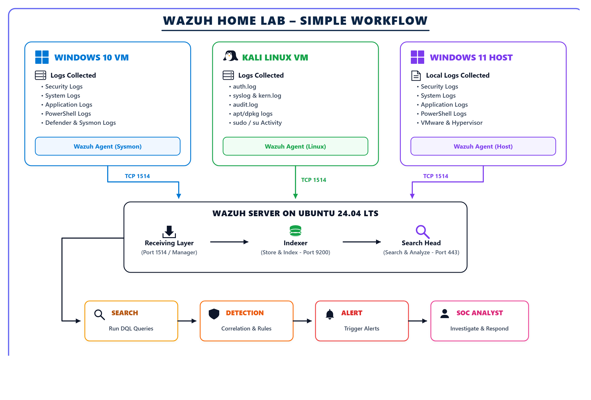
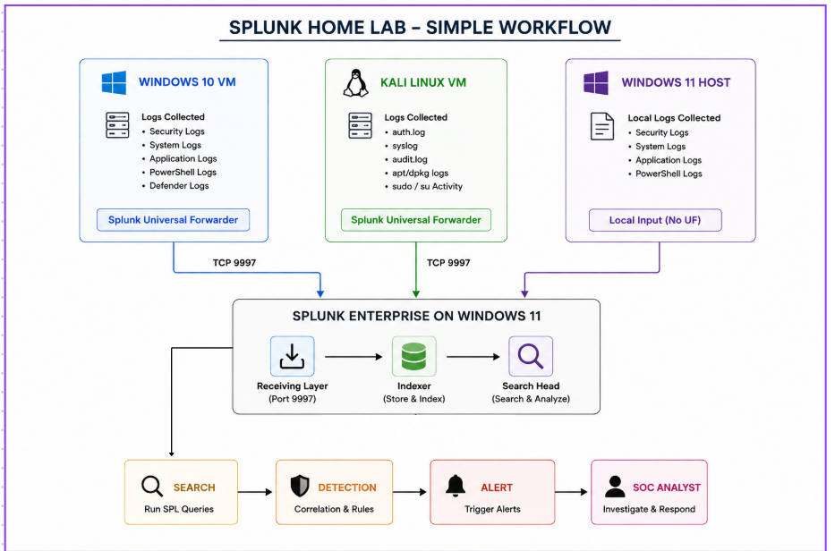
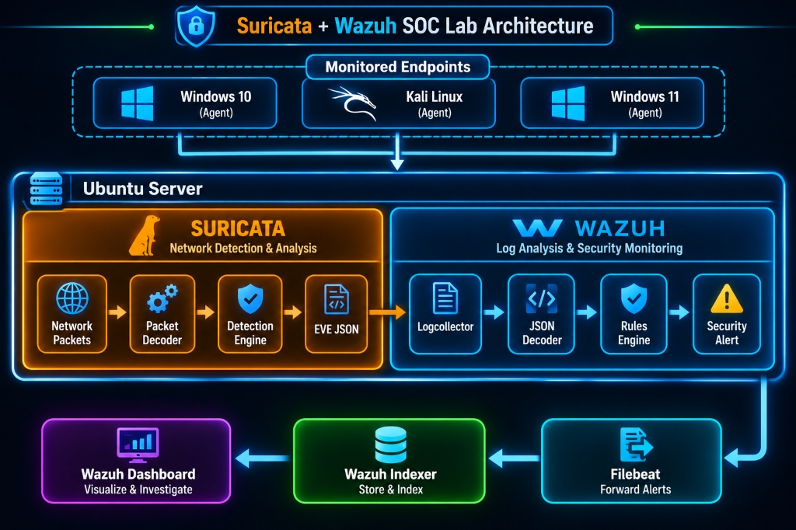

# 🛡️ SOC Home Labs: Multi-SIEM & NIDS Detection Engineering Portfolio
### Wazuh SIEM/XDR · Splunk Enterprise · Suricata NIDS · Hands-On Threat Investigation

[](https://wazuh.com/)
[](https://www.splunk.com/)
[](https://suricata.io/)
[](https://www.microsoft.com/windows)
[](https://ubuntu.com/)
[](https://www.kali.org/)
[](https://www.microsoft.com/windows)
[](LICENSE)

> A comprehensive, production-grade Security Operations Center (SOC) laboratory portfolio featuring end-to-end deployments of **Wazuh 4.14.9** (Open-Source SIEM/XDR), **Splunk Enterprise 10.4.2** (Industry-Standard SIEM), and **Suricata 8.0.8** (High-Performance Network IDS). This repository consolidates host-based telemetry ingestion (Sysmon, Linux auditd, systemd-journald), network deep packet inspection (AF_PACKET, 53,500+ signatures), and cross-platform MITRE ATT&CK detection engineering into a unified defensive portfolio.

---

## 📸 SOC Architecture & Lab Workflows

### 1. Wazuh SOC Home Lab Workflow
The Wazuh lab leverages an all-in-one **Ubuntu Server 24.04 LTS VM** acting as the central Manager, OpenSearch Indexer, Filebeat shipper, and Dashboard. Agents forward secure telemetry over **TCP port 1514**.

[](images/wazuh_workflow_diagram.png)

---

### 2. Splunk SOC Home Lab Workflow
The Splunk lab establishes a centralized **Splunk Enterprise 10.4.2** server combining Indexer and Search Head capabilities on a **Windows 11 Host**, collecting cross-platform forwarder streams over **TCP port 9997**.

[](images/splunk_workflow_diagram.png)

---

### 3. Suricata NIDS + Wazuh SIEM Integration Workflow
The Suricata lab pairs a multi-threaded **Suricata 8.0.8 NIDS** engine with the central **Wazuh 4.14.9 Manager** on Ubuntu Server. It performs real-time deep packet inspection on interface `ens33` via `AF_PACKET`, evaluates traffic against 53,500+ signatures (ET Open + OISF TrafficID), and streams normalized `eve.json` telemetry into Wazuh's native Logcollector for unified SIEM alert correlation and threat hunting.

[](images/suricata_workflow_diagram.jpg)

---

## 📁 Repository Structure & Lab Directory

```text
SOC_Labs/
├── Wazuh_SOC_Lab/                      # Wazuh SIEM & XDR Monitoring Lab (Host Telemetry & FIM)
├── Splunk_SOC_Lab/                     # Splunk Enterprise Centralized SIEM Lab (SPL Analytics)
├── Wazuh_Suricata_Lab/                 # Suricata NIDS + Wazuh SIEM Integration Lab (Network IDS)
├── Lab 3/                              # Upcoming
└── Lab 4/                              # Upcoming
```

| Lab Environment | Primary Technology | Scope & Status | Directory Link |
| :--- | :--- | :--- | :--- |
| **Wazuh SOC Home Lab** | Wazuh 4.14.9 · Ubuntu 24.04 LTS · OpenSearch | Full SIEM/XDR deployment, Sysmon, journald, DQL detection, XML rules, FIM | [📂 Wazuh_SOC_Lab](Wazuh_SOC_Lab/) |
| **Splunk SOC Home Lab** | Splunk Enterprise 10.4.2 · Windows 11 · Universal Forwarders | Centralized log ingestion, index segregation, SPL detection engineering | [📂 Splunk_SOC_Lab](Splunk_SOC_Lab/) |
| **Suricata NIDS + Wazuh Lab** | Suricata 8.0.8 · AF_PACKET · Wazuh 4.14.9 · EVE JSON | Network IDS, 53k+ ET Open signatures, deep packet inspection, SIEM correlation | [📂 Wazuh_Suricata_Lab](Wazuh_Suricata_Lab/) |
| **Lab 3** | Upcoming SOC Lab | *Coming Soon* | [📂 Lab 3](Lab%203/) |
| **Lab 4** | Upcoming SOC Lab | *Coming Soon* | [📂 Lab 4](Lab%204/) |

---

## ⚖️ Technology Comparison: Wazuh vs. Splunk vs. Suricata

| Dimension | Wazuh 4.14.9 (Host SIEM/XDR) | Splunk Enterprise 10.4.2 (Log Analytics) | Suricata 8.0.8 (Network IDS) |
| :--- | :--- | :--- | :--- |
| **Primary Domain** | Endpoint Detection, HIDS, File Integrity Monitoring | Big Data Log Aggregation & Enterprise Analytics | Deep Packet Inspection & Network Intrusion Detection |
| **Hosting Model** | Dedicated Ubuntu Server 24.04 LTS VM | Native Windows 11 Host Deployment | Co-located on Ubuntu Server (Promiscuous / AF_PACKET) |
| **Ingestion Engine** | Wazuh Agent (TLS over TCP 1514) + AuthD (TCP 1515) | Splunk Universal Forwarder (TCP 9997) + Local Monitor | High-speed kernel ring buffer (`tpacket-v3: yes`) |
| **Query Language** | DQL (Dashboard Query Language) / Lucene / OpenSearch | SPL (Search Processing Language) | EVE JSON filtering (jq) / Correlated Wazuh DQL |
| **Detection Mechanism** | Regex Decoders + Hierarchical XML Rules (Levels 0-16) | SPL Correlation Searches & Scheduled Alerts | 53,500+ Emerging Threats & OISF Signatures |
| **ATT&CK Coverage** | Native MITRE ATT&CK mapping in XML rules | Manual SPL field tagging or Splunk ES correlation | Network behavioral indicators (Command & Control, Scans) |
| **Data Storage** | OpenSearch Distributed Search Cluster (Port 9200) | Splunk Proprietary Hot/Warm/Cold Buckets & TSIDX | Local structured EVE JSON forwarded into Wazuh Indexer |
| **License Model** | 100% Free & Open-Source (Apache 2.0) | Enterprise Trial / Free 500 MB/day Developer License | 100% Free & Open-Source (GPLv2 / OISF) |

---

## 🎯 Core Detection Scenarios Implemented

### 1. Windows Authentication Storms & Brute-Force Logons
- **Objective:** Detect repeated failed authentication attempts indicative of credential stuffing or password spraying.
- **Windows Telemetry:** Security Event ID `4625` (An account failed to log on).
- **Wazuh Rule:** Built-in Rule `60122` (`Logon Failure - Unknown user or bad password`) & Level 10 threshold triggers.
- **Splunk SPL:**
  ```spl
  index=windows10 EventCode=4625 
  | stats count by TargetUserName, WorkstationName, src_ip 
  | sort - count
  ```

### 2. Linux Privilege Escalation & Sudo Abuse
- **Objective:** Alert on unauthorized sudo transitions and privilege escalation attempts.
- **Linux Telemetry:** `/var/log/auth.log`, `systemd-journald`, and `/etc/sudoers` modifications.
- **Wazuh Rule:** Rule `5402` (`Successful sudo to ROOT executed`) mapped to MITRE ATT&CK **T1548.003**.
- **Splunk SPL:**
  ```spl
  index=sh-kali sourcetype=linux_secure "authentication failure" 
  | table _time, host, process, message
  ```

### 3. Process Parent-Child Anomalies & Injection
- **Objective:** Detect suspicious command interpreters launched by uncharacteristic parent processes.
- **Telemetry:** Microsoft Sysmon Event ID `1` (Process Creation) with Command Line auditing.
- **Wazuh DQL Query:**
  ```text
  data.win.eventdata.parentImage: "*powershell.exe" AND data.win.eventdata.image: "*cmd.exe"
  ```
- **Splunk SPL:**
  ```spl
  index=windows10 sourcetype="XmlWinEventLog:Sysmon" EventCode=1 
  | table _time, ParentImage, Image, CommandLine, User
  ```

### 4. File Integrity Monitoring & Credential Tampering
- **Objective:** Track unauthorized modifications to sensitive credential stores and administrative configs.
- **Telemetry:** Wazuh `syscheck` FIM module & Linux `auditd` monitoring `/etc/passwd`, `/etc/shadow`, `/etc/sudoers`.
- **Wazuh DQL Query:**
  ```text
  rule.groups: "syscheck" AND syscheck.path: "/etc/shadow"
  ```
- **Splunk SPL:**
  ```spl
  index=sh-kali sourcetype=linux_audit (key="account_changes" OR key="sudo_changes") 
  | table _time, host, key, name, exe, auid
  ```

### 5. Network Intrusion Detection & Protocol Anomalies (Suricata + Wazuh)
- **Objective:** Intercept and alert on malicious network traffic, protocol command anomalies, and scanning activity.
- **Network Telemetry:** Suricata `AF_PACKET` raw stream inspection on interface `ens33` normalized into `/var/log/suricata/eve.json`.
- **Wazuh Correlation:** Rule `86601` (`Suricata: Alert`) in `0475-suricata_rules.xml` mapped to MITRE ATT&CK **T1071** and **T1046**.
- **Wazuh Threat Hunting Query:**
  ```text
  rule.groups: "suricata" AND rule.level >= 3
  ```

---

## 🚀 Quickstart Playbook

### Running the Wazuh Lab
1. Power on the **Ubuntu Server 24.04 LTS** VM in VMware Workstation.
2. Verify services:
   ```bash
   ssh <UBUNTU_USER>@192.168.x.x
   sudo systemctl is-active wazuh-manager wazuh-indexer wazuh-dashboard filebeat
   ```
3. Open `https://192.168.x.x` in your Windows 11 browser.
4. Full instructions available in [Wazuh_SOC_Lab/docs/deployment.md](Wazuh_SOC_Lab/docs/deployment.md).

### Running the Splunk Lab
1. Start the Splunk Enterprise service on Windows 11:
   ```powershell
   Get-Service Splunkd | Start-Service
   ```
2. Verify port `9997` listening:
   ```powershell
   Get-NetTCPConnection -LocalPort 9997 -State Listen
   ```
3. Open `http://localhost:8000` in your Windows 11 browser.
4. Full instructions available in [Splunk_SOC_Lab/README.md](Splunk_SOC_Lab/README.md).

### Running the Suricata + Wazuh NIDS Lab
1. Start and verify the Suricata engine alongside Wazuh:
   ```bash
   sudo systemctl status suricata wazuh-manager filebeat --no-pager
   ```
2. Stream live Suricata alerts:
   ```bash
   sudo tail -f /var/log/suricata/eve.json | jq 'select(.event_type == "alert")'
   ```
3. Hunt for network threats in the Wazuh Dashboard under **Threat Hunting → Events** (`rule.groups: "suricata"`).
4. Full architecture details available in [Wazuh_Suricata_Lab/README.md](Wazuh_Suricata_Lab/README.md).

---

## 🔒 Security & Privacy Standards

- **Anonymized IP Addressing**: All IP addresses across configs, guides, and documentation are anonymized using `192.168.x.x` or RFC placeholders.
- **Zero Exposed Secrets**: No real passwords, agent keys, certificates, or personal authentication tokens are committed.
- **Network Isolation**: All virtual machines operate within private VMware NAT/Host-Only subnets with no inbound exposure to public networks.

---

## 👤 Author & Acknowledgments

- **Author & Maintainer:** [@shii9](https://github.com/shii9)
- **Primary Focus:** Security Operations Center (SOC) Analysis, SIEM Architecture, Detection Engineering, and Incident Response.
- **License:** [MIT License](LICENSE)
