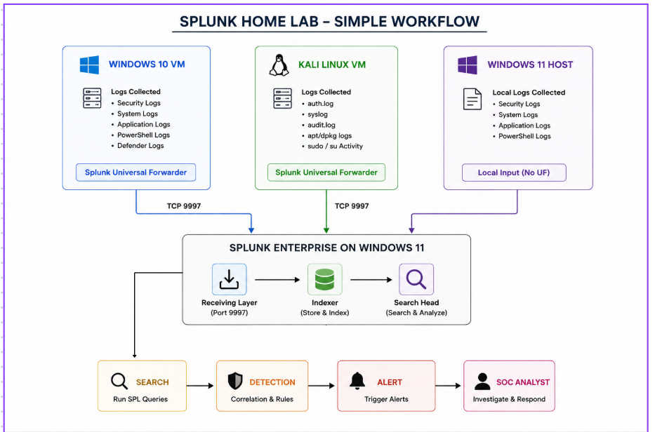

# 🛡️ SOC Home Labs: Dual-SIEM Detection Engineering & Threat Hunting Portfolio
### Wazuh & Splunk Centralized Monitoring · Cross-Platform Telemetry · Hands-On Threat Investigation

[](https://wazuh.com/)
[](https://www.splunk.com/)
[](https://www.microsoft.com/windows)
[](https://ubuntu.com/)
[](https://www.kali.org/)
[](https://www.microsoft.com/windows)
[](LICENSE)

> A comprehensive, production-grade Security Operations Center (SOC) laboratory collection featuring full deployments of both **Wazuh 4.14.9** (Open-Source SIEM/XDR) and **Splunk Enterprise 10.4.2** (Industry-Standard SIEM). This repository consolidates cross-platform telemetry ingestion (Windows 10, Kali Linux, Windows 11), Sysmon integration, Linux audit tuning, MITRE ATT&CK detection engineering into a single, unified reference portfolio.

---

## 📸 Dual-SIEM Architecture & Workflows

### 1. Wazuh SOC Home Lab Workflow
The Wazuh lab leverages an all-in-one **Ubuntu Server 24.04 LTS VM** acting as the central Manager, OpenSearch Indexer, Filebeat shipper, and Dashboard. Agents forward secure telemetry over **TCP port 1514**.

[](images/wazuh_workflow_diagram.png)

---

### 2. Splunk SOC Home Lab Workflow
The Splunk lab establishes a centralized **Splunk Enterprise 10.4.2** server combining Indexer and Search Head capabilities on a **Windows 11 Host**, collecting cross-platform forwarder streams over **TCP port 9997**.

[](images/splunk_workflow_diagram.png)

---

## 📁 Repository Structure & Lab Directory

```text
SOC_Labs/
├── Wazuh_SOC_Lab/                      # Wazuh SIEM & XDR Monitoring Lab
├── Splunk_SOC_Lab/                     # Splunk Enterprise Centralized SIEM Lab
├── Lab 3/                              # Upcoming
└── Lab 4/                              # Upcoming
```

| Lab Environment | Primary Technology | Scope & Status | Directory Link |
| :--- | :--- | :--- | :--- |
| **Wazuh SOC Home Lab** | Wazuh 4.14.9 · Ubuntu 24.04 LTS · OpenSearch | Full SIEM/XDR deployment, Sysmon, journald, DQL detection, XML rules, FIM | [📂 Wazuh_SOC_Lab](Wazuh_SOC_Lab/) |
| **Splunk SOC Home Lab** | Splunk Enterprise 10.4.2 · Windows 11 · Universal Forwarders | Centralized log ingestion, index segregation, SPL detection engineering | [📂 Splunk_SOC_Lab](Splunk_SOC_Lab/) |
| **Lab 3** | Upcoming SOC Lab | *Coming Soon* | [📂 Lab 3](Lab%203/) |
| **Lab 4** | Upcoming SOC Lab | *Coming Soon* | [📂 Lab 4](Lab%204/) |

---

## ⚖️ SIEM Comparison: Wazuh vs. Splunk

| Dimension | Wazuh 4.14.9 (SOC Lab) | Splunk Enterprise 10.4.2 (SOC Lab) |
| :--- | :--- | :--- |
| **Hosting Model** | Dedicated Ubuntu Server 24.04 LTS VM | Native Windows 11 Host Deployment |
| **Agent / Ingestion** | Wazuh Agent (TLS over TCP 1514) + AuthD (TCP 1515) | Splunk Universal Forwarder (TCP 9997) + Local Monitor |
| **Query Language** | DQL (Dashboard Query Language) / Lucene / OpenSearch | SPL (Search Processing Language) |
| **Detection Engine** | Regex Decoders + Hierarchical XML Rules (Levels 0-16) | Search Processing Language (SPL) Correlation Queries |
| **ATT&CK Integration** | Native built-in MITRE ATT&CK tags on XML rule definitions | Manual SPL field tagging or Splunk Enterprise Security (ES) |
| **Data Segregation** | OpenSearch Index Patterns (`wazuh-alerts-*`, `wazuh-archives-*`) | Segregated Custom Indexes (`windows11`, `windows10`, `sh-kali`) |
| **Noise Optimization** | Modular Sysmon XML + Targeted `auditd` rules | Modular Sysmon XML + Targeted `/etc/audit/audit.rules` |
| **Storage Backend** | OpenSearch Distributed Search Cluster (Port 9200) | Splunk Proprietary Hot/Warm/Cold Buckets & TSIDX |
| **License & Footprint** | 100% Free & Open-Source (Apache 2.0) | Enterprise Trial / Free 500 MB/day Developer License |

---

## 🎯 Core Detection Scenarios Implemented

### 1. Windows Authentication Storms & Brute-Force Logons
- **Objective:** Detect repeated failed authentication attempts indicative of credential stuffing or password spraying.
- **Windows Telemetry:** Security Event ID `4625` (An account failed to log on).
- **Wazuh Rule:** Built-in Rule `60122` (`Logon Failure - Unknown user or bad password`) & Level 10 threshold triggers.
- **Splunk SPL:**
  ```spl
  index=windows10 EventCode=4625 
  | stats count by TargetUserName, WorkstationName, src_ip 
  | sort - count
  ```

### 2. Linux Privilege Escalation & Sudo Abuse
- **Objective:** Alert on unauthorized sudo transitions and privilege escalation attempts.
- **Linux Telemetry:** `/var/log/auth.log`, `systemd-journald`, and `/etc/sudoers` modifications.
- **Wazuh Rule:** Rule `5402` (`Successful sudo to ROOT executed`) mapped to MITRE ATT&CK **T1548.003**.
- **Splunk SPL:**
  ```spl
  index=sh-kali sourcetype=linux_secure "authentication failure" 
  | table _time, host, process, message
  ```

### 3. Process Parent-Child Anomalies & Injection
- **Objective:** Detect suspicious command interpreters launched by uncharacteristic parent processes.
- **Telemetry:** Microsoft Sysmon Event ID `1` (Process Creation) with Command Line auditing.
- **Wazuh DQL Query:**
  ```text
  data.win.eventdata.parentImage: "*powershell.exe" AND data.win.eventdata.image: "*cmd.exe"
  ```
- **Splunk SPL:**
  ```spl
  index=windows10 sourcetype="XmlWinEventLog:Sysmon" EventCode=1 
  | table _time, ParentImage, Image, CommandLine, User
  ```

### 4. File Integrity Monitoring & Credential Tampering
- **Objective:** Track unauthorized modifications to sensitive credential stores and administrative configs.
- **Telemetry:** Wazuh `syscheck` FIM module & Linux `auditd` monitoring `/etc/passwd`, `/etc/shadow`, `/etc/sudoers`.
- **Wazuh DQL Query:**
  ```text
  rule.groups: "syscheck" AND syscheck.path: "/etc/shadow"
  ```
- **Splunk SPL:**
  ```spl
  index=sh-kali sourcetype=linux_audit (key="account_changes" OR key="sudo_changes") 
  | table _time, host, key, name, exe, auid
  ```

---

## 🚀 Quickstart Playbook

### Running the Wazuh Lab
1. Power on the **Ubuntu Server 24.04 LTS** VM in VMware Workstation.
2. Verify services:
   ```bash
   ssh <UBUNTU_USER>@192.168.x.x
   sudo systemctl is-active wazuh-manager wazuh-indexer wazuh-dashboard filebeat
   ```
3. Open `https://192.168.x.x` in your Windows 11 browser.
4. Full instructions available in [Wazuh_SOC_Lab/docs/deployment.md](Wazuh_SOC_Lab/docs/deployment.md).

### Running the Splunk Lab
1. Start the Splunk Enterprise service on Windows 11:
   ```powershell
   Get-Service Splunkd | Start-Service
   ```
2. Verify port `9997` listening:
   ```powershell
   Get-NetTCPConnection -LocalPort 9997 -State Listen
   ```
3. Open `http://localhost:8000` in your Windows 11 browser.
4. Full instructions available in [Splunk_SOC_Lab/README.md](Splunk_SOC_Lab/README.md).

---

## 🔒 Security & Privacy Standards

- **Anonymized IP Addressing**: All IP addresses across configs, guides, and documentation are anonymized using `192.168.x.x`.
- **Zero Exposed Secrets**: No real passwords, agent keys, certificates, or personal authentication tokens are committed.
- **Network Isolation**: All virtual machines operate within private VMware NAT/Host-Only subnets with no inbound exposure to public networks.

---

## 👤 Author & Acknowledgments

- **Author & Maintainer:** [@shii9](https://github.com/shii9)
- **Primary Focus:** Security Operations Center (SOC) Analysis, SIEM Architecture, Detection Engineering, and Incident Response.
- **License:** [MIT License](LICENSE)
