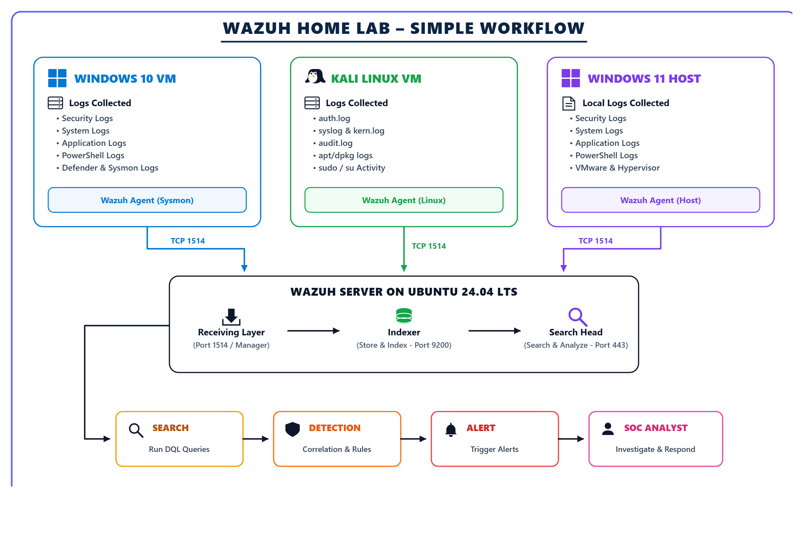
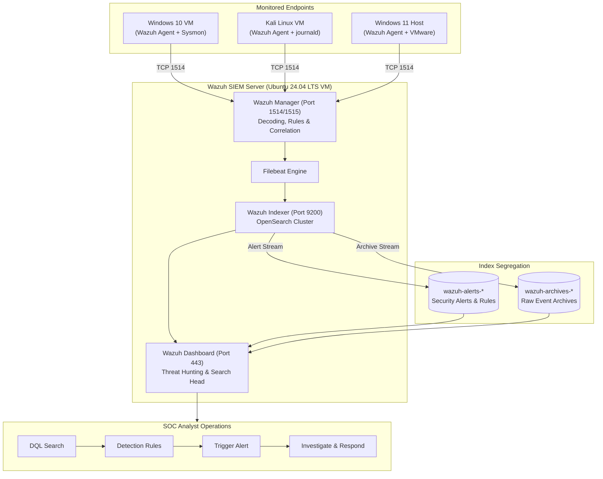

# 🛡️ Wazuh SOC Home Lab: Centralized Windows & Linux Security Monitoring

[](https://wazuh.com/)
[](https://www.microsoft.com/windows)
[](https://ubuntu.com/)
[](https://www.microsoft.com/windows)
[](https://www.kali.org/)
[](LICENSE)

> A multi-OS Security Operations Center (SOC) laboratory implementing centralized log ingestion, security telemetry forwarding, Sysmon event monitoring, Linux audit tuning, OpenSearch index segregation, DQL detection engineering, MITRE ATT&CK correlation, and incident response workflows using **Wazuh 4.14.9** on **Ubuntu Server 24.04 LTS**.

---

## 📸 Executive Summary & Visual Workflow

This repository documents the end-to-end architecture and detection capabilities of a centralized open-source SIEM environment. The Wazuh Server running on an **Ubuntu Server 24.04 LTS VM** acts as a central receiving, decoding, indexing, search, and alerting engine. Security telemetry is forwarded near real-time over **TCP port 1514** from a **Windows 10 VM (with Sysmon)** and a **Kali Linux VM (with journald & auditd)**, alongside a monitored **Windows 11 Host**.

[](images/workflow_diagram.png)
---

## 🎯 Objectives & Project Scope

- **Centralized SIEM Deployment**: Establish an all-in-one Wazuh 4.14.9 server stack combining Manager, Indexer (OpenSearch), Dashboard, and Filebeat on an Ubuntu Server 24.04 LTS VM.
- **Cross-Platform Telemetry Collection**: Ingest Windows Event Logs (Security, System, Application, PowerShell, Defender), Sysmon telemetry (Process, Network, Registry), and Linux telemetry (`auth.log`, `systemd-journald`, `auditd`, `apt/dpkg`).
- **Data Pipeline & Index Segregation**: Structure incoming telemetry streams into dedicated OpenSearch index patterns (`wazuh-alerts-*` for rule matches, optional `wazuh-archives-*` for full raw logging).
- **Noise Optimization & FIM**: Deploy high-signal Microsoft Sysmon XML configurations and tuned Linux `auditd` rules (`/etc/passwd`, `/etc/shadow`, `/etc/sudoers`) to suppress baseline noise and capture critical attacker tradecraft.
- **Detection Engineering & MITRE ATT&CK**: Validate out-of-the-box decoders and author custom XML detection rules for brute-force logon storms, unauthorized privilege escalations, process parentage anomalies, and file tampering.

---

## 🏗️ Lab Architecture & Data Flow

### Mermaid Interactive Topology



### Network Communication Pathways

| Network Pathway | Port / Protocol | Purpose | Scope |
| :--- | :---: | :--- | :--- |
| **Agent → Manager** | TCP 1514 | Agent telemetry forwarding & periodic heartbeat | Private lab network only |
| **Agent → Manager** | TCP 1515 | Agent automated enrollment (`wazuh-authd`) | Private lab network only |
| **Browser → Dashboard** | TCP 443 (HTTPS) | SOC Analyst web portal, search, and triage | Host / trusted management subnet |
| **Dashboard → Wazuh API** | TCP 55000 | Agent administration & cluster status API | Central server / loopback |
| **Filebeat → Indexer** | TCP 9200 | Shipping alerts and archives to OpenSearch | Central server / loopback |
| **Windows Host → Ubuntu** | TCP 22 (SSH) | Administrative management & maintenance | Host / trusted management subnet |

---

## 📋 Index & Telemetry Mapping

| Source Machine | Agent ID | Ingested Log Channels / Telemetry | Primary Decoders / Sourcetypes | Storage Index Pattern |
| :--- | :---: | :--- | :--- | :--- |
| **Windows 10 VM** | `001` | Security, System, Application, Sysmon (`Microsoft-Windows-Sysmon/Operational`), PowerShell | `windows`, `sysmon_process_creation`, `sysmon_event13` | `wazuh-alerts-*`, `wazuh-archives-*` |
| **Kali Linux VM** | `002` | `/var/log/auth.log`, `systemd-journald`, `auditd`, `dpkg.log`, `apt/history.log` | `syslog`, `journald`, `auditd`, `pam`, `sudo` | `wazuh-alerts-*`, `wazuh-archives-*` |
| **Windows 11 Host** | `003` | Security, System, Application, PowerShell Operational, VMware hypervisor events | `windows`, `windows_eventchannel` | `wazuh-alerts-*`, `wazuh-archives-*` |

---

## 🛠️ Setup & Implementation Guide

### Phase 1: Ubuntu 24.04 LTS Wazuh Server Deployment

1. Deploy an **Ubuntu Server 24.04 LTS** virtual machine in VMware Workstation.
2. Run the Wazuh all-in-one assistant installation:
   ```bash
   curl -sO https://packages.wazuh.com/4.14/wazuh-install.sh
   sudo bash ./wazuh-install.sh -a
   ```
3. Verify that all central services are active:
   ```bash
   sudo systemctl is-active wazuh-manager wazuh-indexer wazuh-dashboard filebeat
   sudo /var/ossec/bin/agent_control -l
   ```
   *Or execute the non-destructive verification helper:* [`scripts/ubuntu/health-check.sh`](scripts/ubuntu/health-check.sh).

4. Access the web dashboard on the Windows 11 host by opening `https://192.168.x.x` in a browser.

---

### Phase 2: Windows 11 Host Wazuh Agent Setup

1. Download and install the Wazuh Windows Agent (`wazuh-agent-4.14.9.msi`).
2. Enroll the agent pointing to the Wazuh Manager IP:
   ```powershell
   & "C:\Program Files (x86)\ossec-agent\agent-auth.exe" -m 192.168.x.x -p 1515 -A WIN11-SOC-HOST
   Start-Service WazuhSvc
   ```
3. Configure Windows EventChannels:
   - 📄 Client Example: [`configs/windows11/client-example.xml`](configs/windows11/client-example.xml)
   - 📄 EventChannels Snippet: [`configs/windows11/eventchannels-snippet.xml`](configs/windows11/eventchannels-snippet.xml)

---

### Phase 3: Windows 10 VM Agent & Sysmon Deployment

1. Install Microsoft Sysmon with a modular security configuration:
   ```cmd
   sysmon64.exe -i sysmonconfig.xml
   ```
2. Deploy the Wazuh Agent using the helper script: [`scripts/windows/Install-WazuhAgent.ps1`](scripts/windows/Install-WazuhAgent.ps1).
3. In `C:\Program Files (x86)\ossec-agent\ossec.conf`, enable the Sysmon EventChannel:
   - 📄 Configuration file: [`configs/windows10/eventchannels-snippet.xml`](configs/windows10/eventchannels-snippet.xml)

```xml
<localfile>
  <location>Microsoft-Windows-Sysmon/Operational</location>
  <log_format>eventchannel</log_format>
</localfile>
```

#### High-Value Windows Security & Sysmon Event IDs Monitored

| Event ID | Source | Security Meaning & SOC Relevance |
| :---: | :---: | :--- |
| **4624** | Windows Security | Successful user logon authentication |
| **4625** | Windows Security | Failed user logon authentication (Brute-force indicator) |
| **4672** | Windows Security | Special privileges assigned to new logon (`Administrator`) |
| **4688** | Windows Security | New Process Creation (Command line auditing) |
| **4720** | Windows Security | User account created |
| **4726** | Windows Security | User account deleted |
| **4732** | Windows Security | Member added to local security group (Privilege escalation) |
| **Sysmon 1** | Sysmon Operational | Process Creation (Includes ParentImage, CommandLine, Hashes) |
| **Sysmon 3** | Sysmon Operational | Network connection detected (C2 communication / port scan) |
| **Sysmon 11** | Sysmon Operational | File Create (Ransomware / dropper detection) |
| **Sysmon 13** | Sysmon Operational | Registry value set (Persistence mechanism) |

---

### Phase 4: Kali Linux VM Agent & Audit Tuning

1. Install the Wazuh Agent on Kali Linux using [`scripts/kali/install-agent.sh`](scripts/kali/install-agent.sh):
   ```bash
   sudo WAZUH_MANAGER="192.168.x.x" WAZUH_AGENT_NAME="KALI-SOC-LAB" dpkg -i wazuh-agent_4.14.9-1_amd64.deb
   sudo systemctl enable --now wazuh-agent
   ```

2. Forward `systemd-journald` events to Wazuh:
   - 📄 Configuration file: [`configs/kali/journald-snippet.xml`](configs/kali/journald-snippet.xml)

3. Deploy targeted `auditd` rules to eliminate noise and focus on credential and FIM modifications:
   - 📄 Configuration file: [`configs/kali/auditd-optional.rules`](configs/kali/auditd-optional.rules)

```ini
# Account database and credential modifications
-w /etc/passwd -p wa -k identity_tampering
-w /etc/shadow -p wa -k credential_tampering
-w /etc/group -p wa -k group_modifications

# Privilege escalation and sudo monitoring
-w /etc/sudoers -p wa -k privilege_tampering
-w /etc/sudoers.d/ -p wa -k privilege_tampering

# SSH configuration and persistence monitoring
-w /etc/ssh/sshd_config -p wa -k sshd_tampering
-w /etc/crontab -p wa -k cron_tampering
```

4. Configure File Integrity Monitoring (FIM):
   - 📄 Configuration file: [`configs/kali/fim-snippet.xml`](configs/kali/fim-snippet.xml)

---

## 🔍 Verification & DQL Search Queries

### 1. Agent Connectivity & Status Verification
In the Wazuh Dashboard or via Manager CLI:
```bash
sudo /var/ossec/bin/agent_control -l
```
In OpenSearch / Wazuh Dashboard Discover (`wazuh-alerts-*`):
```text
agent.name: "WIN10-SOC-LAB" OR agent.name: "KALI-SOC-LAB" OR agent.name: "WIN11-SOC-HOST"
```

### 2. Windows Brute-Force Logon Storms (Event 4625)
Filter for authentication failures grouped by source IP or target username:
```text
rule.id: "60122" OR (data.win.system.eventID: "4625" AND agent.name: "WIN10-SOC-LAB")
```

### 3. Linux Sudo Privilege Escalation & Abuse (Rule 5402)
Capture successful root transitions and MITRE ATT&CK **T1548.003**:
```text
rule.id: "5402" AND agent.name: "KALI-SOC-LAB"
```

### 4. Sysmon Process Creation & Parent-Child Anomalies
Search for suspicious command-line executions or script interpreters:
```text
data.win.eventdata.parentImage: "*powershell.exe" AND data.win.eventdata.image: "*cmd.exe"
```

### 5. File Integrity Monitoring (FIM / syscheck)
Detect modified system configuration files:
```text
rule.groups: "syscheck" AND syscheck.path: "/etc/shadow"
```

---

## 🛡️ Security & Operational Best Practices

1. **Network Isolation**: Restrict virtual machines to VMware NAT or Host-Only adapters; never expose Wazuh management ports to public interfaces.
2. **Firewall Scoping**: Permit inbound traffic on TCP 1514 and 1515 only from recognized lab IP subnets (`192.168.x.x`).
3. **Time Synchronization**: Maintain accurate NTP synchronization across host and guest operating systems to ensure cohesive forensic timeline analysis.
4. **Index Scoping & Rotation**: Periodically purge or compress historical indices in OpenSearch to preserve VM disk capacity during long-term simulations.
5. **Credential Hygiene**: Anonymize all IP addresses, API secrets, and agent registration passwords when committing configs or exporting reports.

---

## 🚀 Future Enhancements & Roadmap

- [x] **Single-Instance Ubuntu Wazuh Server**: Complete with Manager, Indexer, and Dashboard.
- [x] **Multi-OS Telemetry Collection**: Windows 10, Kali Linux, and Windows 11 host visibility.
- [x] **Microsoft Sysmon Deployment**: Ingest Event IDs 1, 3, 11, and 13.
- [x] **Linux Audit & Journald Pipeline**: Elimination of syscall noise with custom `audit.rules`.
- [ ] **Zeek / Suricata Network IDS Integration**: Forward raw network threat metadata into Wazuh.
- [ ] **Active Directory Domain Controller VM**: Monitor Kerberos authentication (Kerberoasting / AS-REP Roasting).
- [ ] **Automated Incident Response (Active Response)**: Configure script execution to isolate compromised endpoints upon high-severity alert triggers.

---

## 📚 Documentation Navigation & Companion Microsite

A standalone visual microsite is provided at [`site/index.html`](site/index.html). Open that file in any web browser to explore interactive topologies, data pipelines, and evidence galleries without spinning up a web server.

| Document | Purpose & Contents |
| :--- | :--- |
| [01 — Architecture](docs/architecture.md) | Component responsibilities, trust boundaries, and network diagrams |
| [02 — Deployment](docs/deployment.md) | Step-by-step playbook for Ubuntu, Windows, Sysmon, and Kali |
| [03 — Telemetry Collection](docs/telemetry.md) | Windows EventChannels, Sysmon, journald, and archive queries |
| [04 — SOC Operations](docs/operations.md) | Boot order, service health, backups, snapshots, and recovery |
| [05 — Detection Engineering](docs/detection-engineering.md) | Rule creation, MITRE ATT&CK mapping, and simulation tests |
| [06 — Validation & Evidence](docs/validation.md) | Verification matrix, test logs, and confirmed telemetry |
| [07 — Troubleshooting](docs/troubleshooting.md) | Solutions to real problems encountered during lab setup |
| [08 — Security & Limitations](docs/security.md) | Hardening recommendations, retention, and educational scope |
| [09 — Roadmap](docs/roadmap.md) | Feature enhancement backlog and future milestones |
| [Research References](docs/references.md) | Official documentation links and software baselines |
| [Full Project Report](Wazuh_SOC_Home_Lab_Project_Report.md) | Comprehensive, portfolio-grade technical report |

---

*Project Created & Maintained by [@shii9](https://github.com/shii9) for SOC Analysis & Detection Engineering Learning.*
