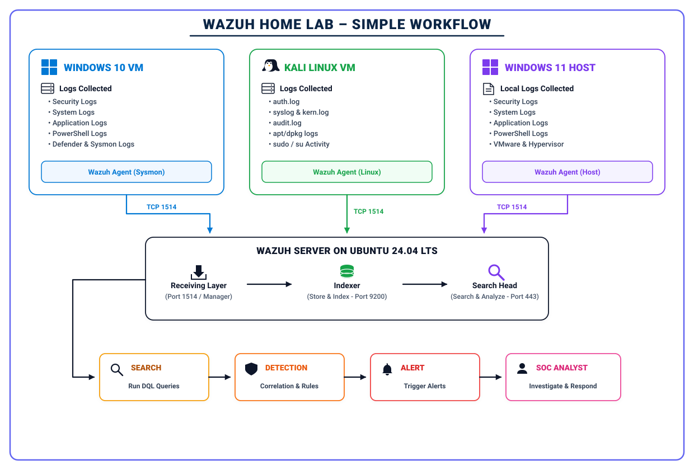
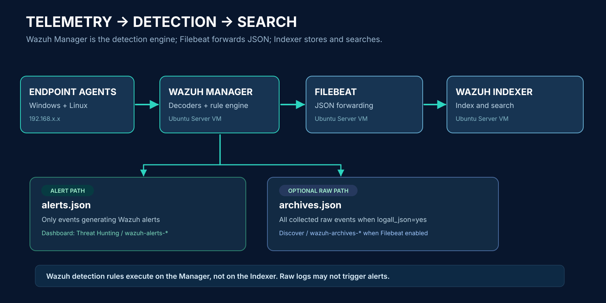

# CENTRALIZED WAZUH SECURITY OPERATIONS CENTER HOME LAB

## Multi-OS Security Monitoring, Sysmon Telemetry, Ubuntu Server SIEM Architecture, Validation and SOC Detection Engineering

**Implementation snapshot:** 26 October 2026 · **Core platform:** Wazuh 4.14.9 · **Virtualization:** VMware Workstation · **Author:** shii9

## Executive summary

This project documents the setup and validation of a centralized multi-endpoint SOC laboratory. Rather than hosting Splunk Enterprise on the Windows 11 desktop as in a prior project, the new deployment uses **Wazuh Manager, Wazuh Indexer, Wazuh Dashboard and Filebeat on an Ubuntu Server 24.04 LTS VM**, accessed from the Windows 11 host through HTTPS and SSH. Wazuh agents monitor Windows 10, Kali Linux and the Windows 11 physical host over a reachable VMware virtual network.

A high-signal pipeline was demonstrated using Windows Event Channels, Sysmon, systemd-journald and built-in Wazuh detection logic. Evidence includes Windows 10 Event ID 101 reaching `archives.json`, Sysmon Event ID 13 captured on Windows 10 and forwarded to Ubuntu, a Kali journal test message, a built-in Wazuh rule 5402 sudo alert, a historical dashboard view with 431 Windows 10 alert hits, and a Wazuh Manager inventory listing all three agents registered, with Kali and Windows 11 Active at the final snapshot. Windows 11 raw event forwarding remains a distinct pending test.

The report distinguishes observed facts from design recommendations and demonstrates both ingestion and Wazuh rule analysis. All IP addresses are intentionally masked as `192.168.x.x` in published material. The environment is a **single-node educational home lab**, not an HA production SOC.

## 1. Problem statement and project objectives

Modern SOC workflows require a unified view of Windows and Linux activity. Endpoint-only logs create silos, hinder correlation and make reproducible investigations difficult. The project objectives are: (1) deploy an independent Linux-hosted SIEM, (2) establish encrypted agent communication from heterogeneous operating systems, (3) distinguish alerts from raw event archives, (4) validate the complete pipeline with safe test events and (5) build a foundation for ATT&CK-aware detection engineering.

## 2. Lab architecture

| Layer | Components | Responsibility |
|---|---|---|
| Endpoints | Windows 10 / Kali / Windows 11 agents | Collect authorized OS telemetry and endpoint metadata |
| Collection & detection | Ubuntu Wazuh Manager | Receive events, decode, correlate and evaluate detection rules |
| Shipping | Filebeat on Ubuntu | Forward generated alerts and optional raw archives |
| Index and search | Wazuh Indexer | Store and query event documents |
| Analyst UI | Wazuh Dashboard | Search alert/indexed archive data; inspect agent status via API |
| Administration | Windows 11 browser + SSH | Access running VM, review health, administer configuration |

**Rule-engine placement matters:** the Manager does the Wazuh security detection; the Indexer stores searchable documents. Wazuh API (default TCP 55000) and Indexer API (TCP 9200) should remain protected on the central machine. Endpoint telemetry uses TCP 1514 by default, and enrollment uses TCP 1515.

## 3. Environment and resources

- Hypervisor: VMware Workstation on a Windows 11 physical host.
- Central SIEM: Ubuntu Server 24.04 LTS VM with Wazuh 4.14.9 all-in-one components.
- Monitored Windows VM: Windows 10 plus Microsoft Sysmon and Wazuh Agent.
- Monitored Linux VM: Kali Linux and Wazuh Agent with journald.
- Physical host: Windows 11 with Wazuh Agent plus browser and SSH administrative access.
- All nodes: anonymized IPs `192.168.x.x`, accessible through the private VMware network.
- Typical small-lab planning: approximately 8 GB RAM / 4 vCPU and 80 GB disk for central VM with storage monitoring; **not an official blanket minimum or measured capacity**.

## 4. Deployment methodology

The central Ubuntu Wazuh stack was deployed using the versioned Wazuh 4.14 installation assistant and validated with systemd, API connectivity and Filebeat checks. Windows 10 Wazuh Agent and Sysmon were configured to collect native EventChannels. Kali Wazuh Agent 4.14.9-1 was installed from the signed official APT repository and configured for journald ingestion. The Windows 11 Agent was recovered from a non-starting installation by correcting configuration structure and administrator privileges; it successfully enrolled and later appeared Active.

Full instructions, exact paths and role-labeled terminal commands are in [deployment](docs/deployment.md).

## 5. Detection and ingest architecture

### 5.1 Windows 10 native EventChannel ingestion

The Wazuh Agent collected Security, System and Application channels. Event ID 101 from `WazuhLabTest` was confirmed in Ubuntu `archives.json` as agent `001`, demonstrating end-to-end native event collection.

### 5.2 Windows 10 Sysmon

A Sysmon Operational `<localfile>` entry was added to the Windows Agent configuration, followed by service restart. Windows `Get-WinEvent` displayed process creation events. The central archive produced a Sysmon Event ID 13 record involving `notepad.exe`, demonstrating registry telemetry forwarding. This observation is **not evidence of a real attack**.

### 5.3 Kali journald and sudo analysis

The Kali Agent's default XML already contained a journald collector. The test `logger -p authpriv.notice -t KaliSOCTest 'Wazuh Kali centralized monitoring test'` appeared in the local journal and then in the Ubuntu archive under agent `KALI-SOC-LAB`. A successful sudo action was recognized by built-in Rule `5402`, level `3`, tagged `T1548.003`. A benign sudo command generating an ATT&CK-tagged alert does not by itself indicate compromise.

### 5.4 Windows 11 host telemetry

The Windows 11 Wazuh Agent was already installed but stopped. Troubleshooting identified lack of PowerShell elevation, initial invalid `0.0.0.0` manager address, a misplaced XML `<enrollment>` block and finally an accidentally truncated `ossec.conf`. Recovery from `.bak` preserved standard settings. Agent `003` enrolled and later reported Active. The Windows 11 Event ID 102 archive forwarding check remains **pending**, so no stronger ingestion claim is made.

## 6. Separation of raw logs and alerts

- Manager `alerts.json` contains triggered Wazuh alerts; Filebeat forwards to `wazuh-alerts-*` for **Threat Hunting**.
- Manager `archives.json` stores all received raw events **if** `<logall_json>yes</logall_json>` is set.
- For full raw event search, Filebeat `archives.enabled=true` is also required, and the Dashboard must have a `wazuh-archives-*` index pattern with `timestamp` time field.
- Raw event ingestion and detection-rule alerting are independently validated stages; a custom Application warning may be visible only in archives.

See [telemetry engineering](docs/telemetry.md).

## 7. Verification evidence

The screenshot records 431 alert hits for Windows 10 in the selected 24-hour interval. Separately, raw evidence confirmed Sysmon Event ID 13, Kali journald ingestion, sudo Rule 5402 and Windows 11 Agent Active status. All sensitive network information is redacted in this public repository. For a formal pass/pending matrix see [validation](docs/validation.md).

## 8. Security and risk management

The environment is operated on owned or authorized devices, confined to a trusted private network. It follows basic controls: separate central SIEM VM, narrow ingress ports, protected credentials, awareness of raw log privacy, explicit archive retention planning and VM snapshots. No public endpoint, credentials, token, raw user telemetry or full production-like attack tooling is bundled. Host-based automatic containment is intentionally not enabled.

## 9. Known problems resolved

- Non-elevated PowerShell blocked Windows service management; use Administrator shell.
- Existing Wazuh service meant reinstall attempt was unnecessary (MSI exit 1625).
- Invalid `0.0.0.0` address rejected by agent.
- `<enrollment>` must be nested inside `<client>`; misplacement caused configuration error.
- Truncation of XML file caused unclosed `<ossec_config>`; recovered from full backup.
- `agent_control` and `archives.json` are Ubuntu Manager artifacts, not Kali commands.
- `wazuh-archives-*` is a Dashboard pattern, not a terminal command.
- Offline endpoint VMs become Disconnected; this is normal.

See [troubleshooting](docs/troubleshooting.md).

## 10. SOC workflow and next steps

A basic analyst workflow begins with an alert or event, validates source/host/time, retrieves associated raw records, examines user/process/network context, classifies false positives vs incidents, documents the case and develops tighter rule logic when warranted.

Planned expansions include Windows Defender/PowerShell channels, tighter Sysmon filtering, optional Kali auditd/FIM, custom XML detections, automated rule quality checks, MITRE-based dashboard views and optional Suricata/Zeek. These have not all been deployed or validated. See [roadmap](docs/roadmap.md).

## 11. Limitations

The system is single-node with no failover. Resource performance, retention and end-to-end alert latency have not been benchmarked. IP masking removes exact addressing from public docs. Dashboard snapshots are historic. Three enrolled agents do not imply all three are always online; Windows 10 was Disconnected during the latest listed snapshot. Test data and built-in rule triggers must not be construed as attacks. Custom rules in this repository are examples and must be tested with `wazuh-logtest` before activation.

## 12. Conclusion

The project demonstrates a reproducible Wazuh SOC learning environment based on an Ubuntu Server SIEM rather than a Windows-hosted Splunk deployment. It verifies heterogeneous endpoint collection and central analysis, captures authentic operational setbacks and their resolutions, and provides a clear path toward professional detection engineering. The repository is designed as a transparent portfolio artifact: verified observations are explicitly distinguished from optional enhancements and future work.

---

**References:** [Official Wazuh documentation](docs/references.md) · [Architecture](docs/architecture.md) · [Deployment](docs/deployment.md) · [Validation](docs/validation.md) · [Related Splunk lab](https://github.com/shii9/SOC_Lab_Setup_Splunk)
