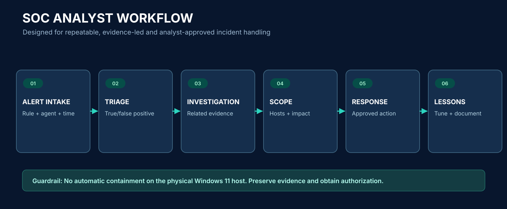

# 05 — Detection engineering and controlled simulations

## Detection coverage philosophy

The lab starts with **known-good telemetry**, then works toward custom rules, false-positive tuning, ATT&CK mapping and repeatable validation. A new alert is only useful if its evidence is interpretable. Keep lab simulations non-destructive and operate only on explicitly authorized VMs.

### Data → detection → triage



| Use case | Main event source | ATT&CK context | Verification |
|---|---|---|---|
| Process execution | Windows 10 Sysmon Event ID 1 | T1059 Command/Scripting Interpreter is context-dependent | Launch Notepad, search archive; benign baseline only |
| Registry modification | Sysmon Event ID 13 | Could support persistence investigation, **not automatically malicious** | Verified Notepad/BAM event reached Manager |
| User created | Windows Security 4720 | T1136.001 local account (only when context supports it) | Query in authorized test environment; do not create production accounts |
| Local group membership | Windows Security 4732 | T1098 account manipulation (context-dependent) | Rule/query review without changing admin groups on host |
| Authentication failures | Windows Security 4625 | T1110 when repeated malicious pattern validated | Inspect known test failure(s); avoid brute force testing |
| Successful sudo | Linux journald | T1548.003 sudo abuse **if suspicious** | Built-in `rule.id:5402` confirmed from benign sudo command |
| Account file changes | Kali FIM optional | T1098 / T1136.001 depending on change | Use harmless file in a dedicated lab folder, not `/etc/shadow` |

MITRE technique labels are **analyst context**, not proof of attacker intent. In this lab, Rule 5402 showed `T1548.003` on ordinary authorized sudo usage.

## Built-in alert tests first

**Kali:**

```bash
sudo true
logger -p authpriv.notice -t KaliSOCTest 'Wazuh Kali centralized monitoring test'
```

**Ubuntu Manager:**

```bash
sudo /var/ossec/bin/agent_control -l
sudo grep -F 'KaliSOCTest' /var/ossec/logs/archives/archives.json | tail -2
```

**Windows 10 (Admin PowerShell):**

```powershell
Start-Process notepad.exe
Get-WinEvent -FilterHashtable @{
  LogName='Microsoft-Windows-Sysmon/Operational'; Id=1
} -MaxEvents 3 | Select-Object TimeCreated,Id,Message
```

Expected results depend on Sysmon filtering rules. Sysmon event 13 was previously confirmed centrally; normal background activity may produce many innocuous events.

**Windows 11 (Admin PowerShell):**

```powershell
eventcreate /L APPLICATION /T WARNING /ID 102 /SO WazuhHostTest /D 'Windows 11 Wazuh centralized monitoring test'
```

Then check Ubuntu archives for `WazuhHostTest`. This is an **uncompleted additional verification case** in the documented state; do not claim it already passed.

## Custom Wazuh rules

The example file [`configs/rules/local_rules.xml`](../configs/rules/local_rules.xml) contains two **laboratory proof-of-concept** rules:

- `100101`: Custom `KaliSOCTest` program tag and expected benign test phrase.
- `100102`: Windows Event ID 102 from `WazuhHostTest` provider.

These demonstrate configuration/testing; they do **not** detect real cyberattacks and must not be marketed as production-ready signatures. Wazuh reserves IDs `100000–120000` for custom rules. They are **not installed by default** in this repository.

### Test before activation (Ubuntu Manager)

1. Back up `/var/ossec/etc/rules/local_rules.xml`.
2. Merge custom `<group>` children (or use a separate custom XML file under `/var/ossec/etc/rules/`); never overwrite working rules blindly.
3. Use `/var/ossec/bin/wazuh-logtest` to test a sample from the intended event source.
4. Confirm decoder, rule ID and severity; restart `wazuh-manager` only after validation.
5. Generate a **new** safe event and verify alert in `wazuh-alerts-*`.
6. Confirm there are no unwanted high-volume alerts, document tuning and rollback.

For a sample journald-like message, paste this into `sudo /var/ossec/bin/wazuh-logtest`:

```text
Oct 26 13:10:34 Sh-Kali KaliSOCTest[12345]: Wazuh Kali centralized monitoring test
```

The exact matching behavior must be confirmed using `wazuh-logtest` on the deployed Wazuh version. If the expected rule does not match, inspect pre-decoding `program_name` and adapt the regex appropriately.

## Example analyst workflows

**1. Sysmon triage:** filter Windows 10 agent and Sysmon provider → review Event IDs 1/13/22 → process, parent, registry target/domain and time → compare to expected Windows background activity → case note.

**2. Linux sudo:** query `agent.name:"KALI-SOC-LAB" AND rule.id:"5402"` → inspect account, command, TTY, working directory → verify permission/maintenance context → record false positive if expected.

**3. Ingestion gap:** identify missing endpoint, check last heartbeat and VM power state, then differentiate agent failure from `Filebeat` / `Indexer` outage and from dashboard time-range issues.

## Detection QA criteria

- A specific test input and expected rule behavior are written down.
- Positive and negative controls are tested.
- Process and identity fields needed for triage are retained.
- Any `MITRE ATT&CK` mapping is justified and not overstated.
- False positives are quantified before increasing severity or enabling active response.
- Rollback procedure exists; accidental self-blocking on the host is prevented.

## Future expansion

Sysmon correlation, Windows authentication enrichment, Wazuh FIM, optional Kali auditd, optional Suricata/Zeek, case tracking and analyst-reviewed containment are [roadmap](roadmap.md) items, not already-deployed features.
