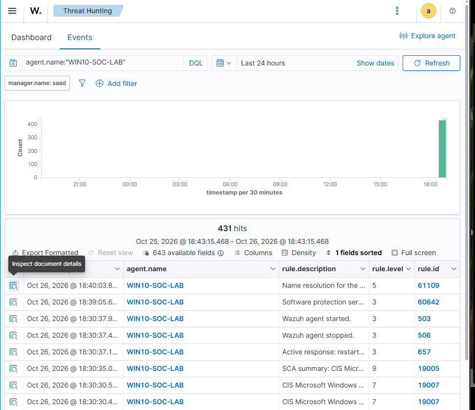
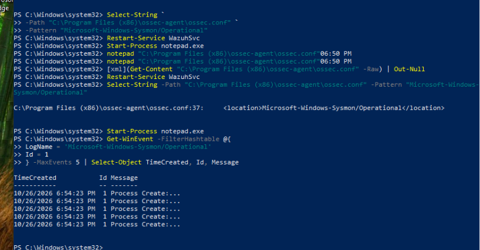

# 06 — Verification matrix and sanitized evidence

This section separates **what was actually observed** from instructions that are available but not yet verified. All addresses have been replaced with `192.168.x.x` in the public record.

## Validation results as of 26 October 2026

| Test | Source/command | Evidence actually observed | Status |
|---|---|---|---|
| TC-01 Central Wazuh health | `systemctl is-active`, API dashboard | Manager/Indexer/Dashboard active, API online in setup | **Observed** |
| TC-02 Filebeat | `filebeat test config`, `filebeat test output` | `Config OK`, indexer TLS handshake / output succeeded | **Observed** |
| TC-03 Windows 10 enrollment | Ubuntu `agent_control -l` | `WIN10-SOC-LAB`, agent 001 Active when powered on | **Observed** |
| TC-04 Win10 native event channel | Manager `archives.json` | Event ID 101 `WazuhLabTest` from WIN10 | **Observed** |
| TC-05 Win10 Sysmon | Manager `archives.json` | Sysmon provider, Event ID 13, Notepad registry write | **Observed** |
| TC-06 Windows 10 dashboard | Threat Hunting filter on Win10 | **431 alert hits** in a historical 24-hour window | **Observed** |
| TC-07 Kali enrollment | Ubuntu `agent_control -l` | `KALI-SOC-LAB` agent 002 Active | **Observed** |
| TC-08 Kali journald | Manager `archives.json` | `KaliSOCTest` with `location: journald` | **Observed** |
| TC-09 Kali built-in alert | Manager `archives.json` | Rule **5402**, level 3; successful sudo | **Observed** |
| TC-10 Windows 11 enrollment | Ubuntu `agent_control -l` | `WIN11-SOC-HOST` agent 003 Active | **Observed** |
| TC-11 Windows 11 raw event | `eventcreate` ID 102 then Manager archives | No returned evidence in chat to prove completion | **Pending verification** |
| TC-12 Custom example rules | `wazuh-logtest` and alert JSON | Example XML supplied but not installed/tested | **Not performed** |

> An earlier snapshot showed Windows 10 `Disconnected` while Kali and Windows 11 were Active. Offline VMs eventually become Disconnected; this is not evidence that the installation failed.

## Real screenshot from the lab



Screenshot is an **authentic historical dashboard view**. It does not show live current connectivity. No network IP appears within this image.

### Local Sysmon verification screenshot



This screenshot shows local Event ID 1 retrieval. It is not independently a Manager-side validation; the Manager Sysmon Event ID 13 record is the separate forwarding evidence.

## Reproduce verified telemetry

### Agent list — Ubuntu Manager ONLY

```bash
sudo /var/ossec/bin/agent_control -l
```

Expected agent names: `WIN10-SOC-LAB`, `KALI-SOC-LAB`, `WIN11-SOC-HOST`. Do not assume the current status will be Active when endpoint VMs are powered off.

### Windows 10 Sysmon evidence — Ubuntu ONLY

```bash
sudo grep -F 'Microsoft-Windows-Sysmon' /var/ossec/logs/archives/archives.json | grep -F 'WIN10-SOC-LAB' | tail -2
```

One previous record contained provider `Microsoft-Windows-Sysmon`, channel `Microsoft-Windows-Sysmon/Operational`, Event ID `13`, Image ending in `notepad.exe` and a registry `TargetObject` under the BAM service key. This is a **telemetry success test**, not an indicator of malware.

### Kali journald evidence — Kali then Ubuntu

On Kali:

```bash
logger -p authpriv.notice -t KaliSOCTest 'Wazuh Kali centralized monitoring test'
sudo journalctl -t KaliSOCTest -n 3 --no-pager
```

On Ubuntu:

```bash
sudo grep -F 'Wazuh Kali centralized monitoring test' /var/ossec/logs/archives/archives.json | grep -F 'KALI-SOC-LAB' | tail -2
```

The original lab returned a Kali journal event plus a separately matched `rule.id:5402` sudo alert, indicating both collection and the Manager's native rule engine were working.

### Windows 11 raw event — **validation pending**

On Windows 11 Admin PowerShell:

```powershell
eventcreate /L APPLICATION /T WARNING /ID 102 /SO WazuhHostTest /D 'Windows 11 Wazuh centralized monitoring test'
```

On Ubuntu:

```bash
sudo grep -F 'Windows 11 Wazuh centralized monitoring test' /var/ossec/logs/archives/archives.json | grep -F 'WIN11-SOC-HOST' | tail -2
```

Expected: a JSON event attributed to `WIN11-SOC-HOST`. Do not mark as pass until verified.

## Screenshots to add later

See [`images/screenshots/README.md`](../images/screenshots/README.md) for the evidence capture plan. Capture agent inventory, three-endpoint status, Sysmon ID 13 in Discover, Kali sudo Rule 5402, Windows 11 Event ID 102 and a clean Dashboard overview. Redact IP addresses and usernames, tokens and any other sensitive fields **before publishing**.
