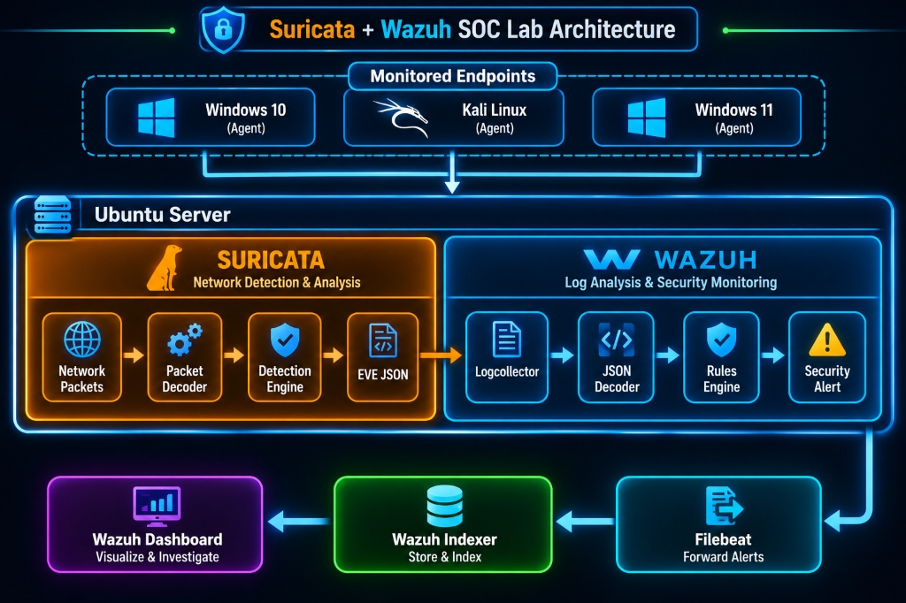
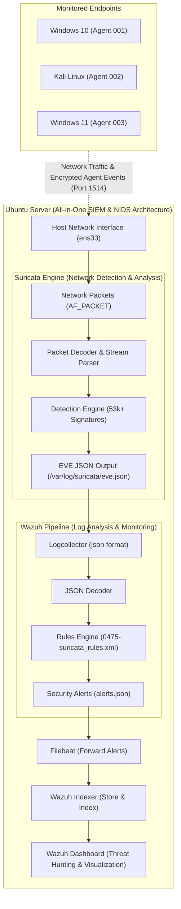

# Suricata NIDS + Wazuh SIEM | SOC Detection Engineering Lab

  
  
  
  
  

A practical SOC detection engineering lab integrating **Suricata Network IDS** with the **Wazuh SIEM Platform**. The system captures live network traffic via high-speed `AF_PACKET`, evaluates packets against 53,500+ threat intelligence signatures (Emerging Threats Open & OISF TrafficID), and streams structured EVE JSON telemetry directly into Wazuh for automated log decoding, security rule correlation, and centralized threat hunting in the Wazuh Dashboard.

---

## Table of Contents

- [1. Executive Summary & Capabilities](#1-executive-summary--capabilities)
- [2. System Architecture & Topology](#2-system-architecture--topology)
  - [2.1 High-Level Architecture Diagram](#21-high-level-architecture-diagram)
  - [2.2 Unified Server Event Pipeline](#22-unified-server-event-pipeline)
  - [2.3 Component Responsibility Matrix](#23-component-responsibility-matrix)
- [3. Monitored Endpoint Fleet](#3-monitored-endpoint-fleet)
- [4. Official References](#4-official-references)

---

## 1. Executive Summary & Capabilities

Modern Security Operations Centers (SOCs) require comprehensive visibility across both endpoint telemetry (EDR/HIDS) and network telemetry (NIDS). This lab establishes a centralized detection and correlation pipeline delivering:

- **High-Speed Network Sniffing:** Multi-threaded packet capture and stream reassembly powered by Suricata's `AF_PACKET` engine on `ens33`.
- **Threat Intelligence Feeds:** Integration with **Emerging Threats Open (ET Open)** and **OISF TrafficID** feeds, compiling over 53,500 active detection signatures.
- **Structured Telemetry Normalization:** Outputting enriched flow, DNS, TLS, HTTP, anomaly, and alert data into Suricata's Extensible Event Format (`eve.json`).
- **SIEM Correlation & Rule Evaluation:** Ingestion by the Wazuh Logcollector and automated parsing through Wazuh's JSON decoder and Suricata ruleset (`0475-suricata_rules.xml`).
- **Enterprise Alert Pipeline:** Seamless delivery via Filebeat into the Wazuh Indexer and interactive visualization in the Wazuh Dashboard.

---

## 2. System Architecture & Topology

### 2.1 High-Level Architecture Diagram

The lab network consists of monitored enterprise endpoints alongside the central Ubuntu security server hosting Suricata and the full Wazuh SIEM stack:

  

### 2.2 Unified Server Event Pipeline

All core processing, analysis, indexing, and visualization services run unified on the central server:

### 2.3 Component Responsibility Matrix

| Component | Layer | Role & Responsibility in Pipeline |
|---|---|---|
| **Raw Network Packets** | Ingress Traffic | Captured from network interface `ens33` via high-performance `AF_PACKET` socket ring buffers. |
| **Suricata Packet Decoder** | Protocol Decoding | Decodes Ethernet, IP, TCP, UDP, and application-layer protocols (HTTP, TLS, DNS). |
| **Suricata Detection Engine** | Threat Detection | Evaluates network traffic against 53,500+ active Suricata signatures (ET Open & OISF TrafficID). |
| **EVE JSON Generation** | Serialization | Converts detected network events into structured JSON format written to `/var/log/suricata/eve.json`. |
| **Wazuh Logcollector** | Telemetry Ingestion | Built-in manager daemon that continuously monitors `eve.json` and forwards records into the analysis queue. |
| **Wazuh JSON Decoder** | Data Normalization | Extracts nested JSON key-value pairs (`data.alert.*`, `data.src_ip`, `data.dest_ip`, `data.proto`) into searchable fields. |
| **Wazuh Rules Engine** | SIEM Correlation | Evaluates parsed events against `0475-suricata_rules.xml`, assigns alert levels (3–12), and outputs to `/var/ossec/logs/alerts/alerts.json`. |
| **Filebeat** | Transport & Shipping | Ships formatted alert documents over TLS to the Wazuh Indexer. |
| **Wazuh Indexer** | Search & Storage | Distributed OpenSearch-based indexer storing documents in `wazuh-alerts-*` indices. |
| **Wazuh Dashboard** | SOC Visual Interface | Provides real-time event exploration, KQL/Lucene querying, and threat hunting visualization. |

---

## 3. Monitored Endpoint Fleet

| System Name | Operating System | Wazuh Agent ID | Communication Channel | Role |
|---|---|:---:|---|---|
| **`wazuh-server`** | Ubuntu Server 22.04/24.04 | `000` | Local System / Logcollector | Central SIEM & NIDS Host |
| **`WIN10-SOC-LAB`** | Windows 10 Pro | `001` | TCP 1514 (AES Encrypted) | Monitored Host |
| **`KALI-SOC-LAB`** | Kali Linux Rolling | `002` | TCP 1514 (AES Encrypted) | Security Testing & Attack Emulation |
| **`WIN11-SOC-HOST`** | Windows 11 Enterprise | `003` | TCP 1514 (AES Encrypted) | Monitored Host / Active |

---

## 4. Official References

- [Wazuh Documentation — Network IDS Integration with Suricata](https://documentation.wazuh.com/current/proof-of-concept-guide/integrate-network-ids-suricata.html)
- [Wazuh Documentation — Local Log Data Collection (`localfile`)](https://documentation.wazuh.com/current/user-manual/capabilities/log-data-collection/index.html)
- [Wazuh Documentation — Ruleset and Decoder Architecture](https://documentation.wazuh.com/current/user-manual/ruleset/index.html)
- [Suricata Documentation — Quickstart & Configuration Guide](https://docs.suricata.io/en/latest/quickstart.html)
- [Suricata Documentation — AF_PACKET High Speed Capture](https://docs.suricata.io/en/latest/capture-hardware/af-packet.html)
- [Suricata Documentation — EVE JSON Output Format](https://docs.suricata.io/en/latest/output/eve/eve-json-output.html)
- [Suricata-Update Documentation — Managing Threat Feeds](https://docs.suricata.io/en/latest/rule-management/suricata-update.html)

---

  <b>SOC Engineering Lab</b> • Crafted for high-fidelity detection engineering and defensive security operations.

