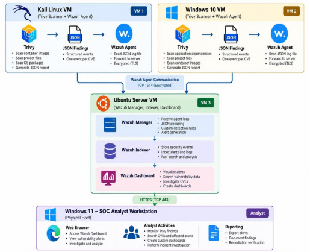
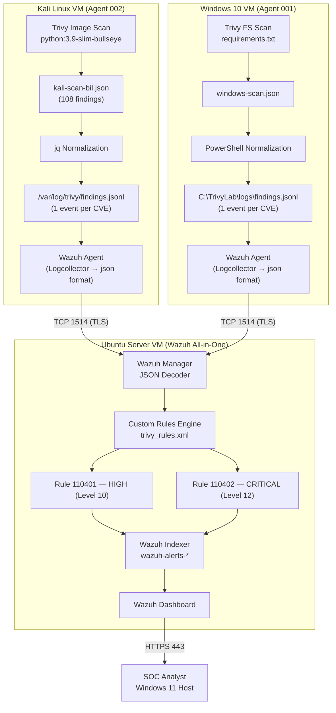
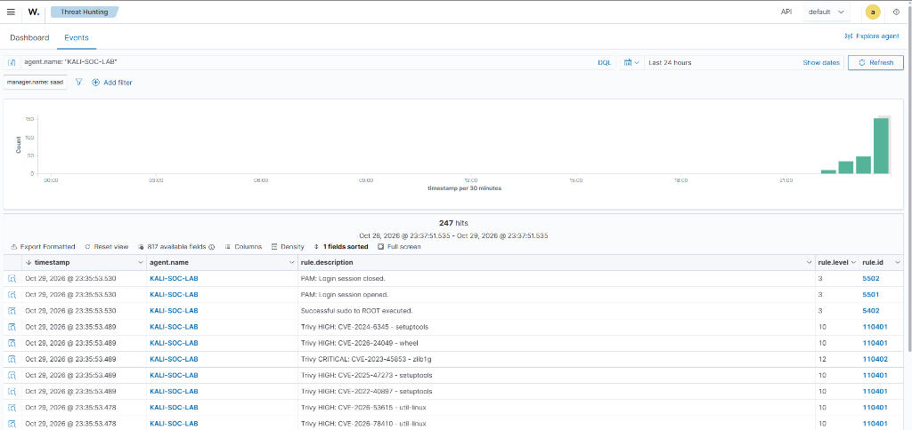
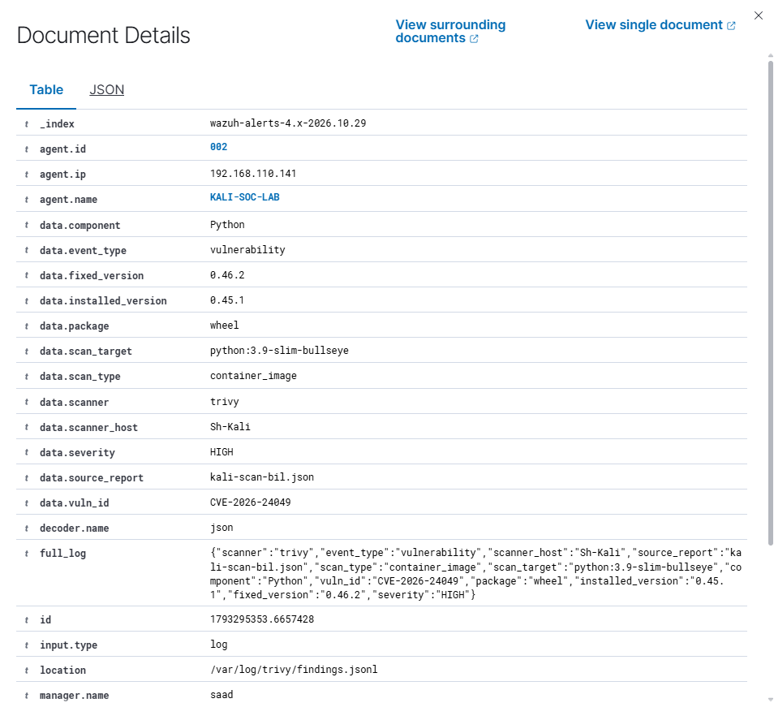
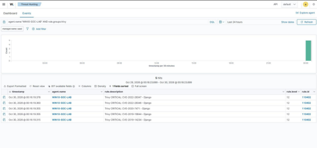
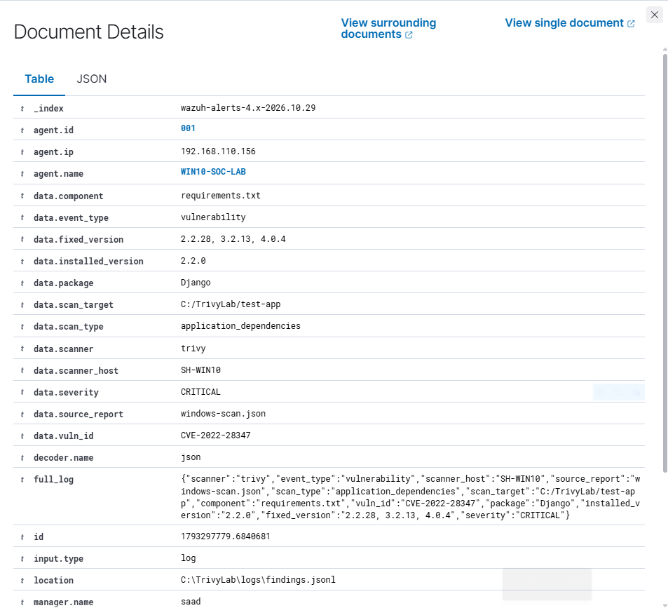

# Trivy Vulnerability Scanner + Wazuh SIEM | SOC Vulnerability Monitoring Lab

  
  
  
  
  

A practical SOC vulnerability monitoring lab integrating **Trivy Vulnerability Scanner** with the **Wazuh SIEM Platform**. The system performs automated vulnerability assessments of container images and application dependencies across Linux and Windows endpoints, normalizes findings into structured JSONL events, and forwards them through existing Wazuh Agents to the centralized Ubuntu Wazuh Manager for severity-based detection, alerting, and threat hunting.

> **📄 View Full Lab Report (PDF):** [Trivy with Wazuh.pdf](Trivy%20with%20Wazuh.pdf) *(Native report converted directly from original docx)*

---

## Table of Contents

- [1. Executive Summary & Capabilities](#1-executive-summary--capabilities)
- [2. System Architecture & Topology](#2-system-architecture--topology)
  - [2.1 High-Level Architecture Diagram](#21-high-level-architecture-diagram)
  - [2.2 End-to-End Event Pipeline](#22-end-to-end-event-pipeline)
  - [2.3 Component Responsibility Matrix](#23-component-responsibility-matrix)
- [3. Monitored Endpoint Fleet](#3-monitored-endpoint-fleet)
- [4. Custom Detection Rules](#4-custom-detection-rules)
- [5. Observed Detection Evidence & Verification](#5-observed-detection-evidence--verification)
  - [5.1 Kali Linux VM — Container Image Vulnerability Alerts](#51-kali-linux-vm--container-image-vulnerability-alerts)
  - [5.2 Windows 10 VM — Application Dependency Alerts](#52-windows-10-vm--application-dependency-alerts)
- [6. Official References](#6-official-references)

---

## 1. Executive Summary & Capabilities

Traditional vulnerability scanners generate static reports that require manual review. This lab bridges that gap by converting Trivy scan output into a live SIEM event stream, enabling SOC analysts to:

- **Scan Container Images:** Detect HIGH and CRITICAL CVEs in Docker images (e.g., `python:3.9-slim-bullseye`) from Kali Linux.
- **Scan Application Dependencies:** Identify vulnerable Python packages (e.g., Django 2.2.0) declared in `requirements.txt` from Windows 10.
- **Normalize & Forward:** Convert nested Trivy JSON into flat JSONL events — one event per CVE — for Wazuh Agent collection.
- **Centralized Detection:** Apply severity-based custom rules (110401 HIGH / 110402 CRITICAL) on the Wazuh Manager.
- **Unified Threat Hunting:** Investigate vulnerability findings alongside endpoint telemetry in the Wazuh Dashboard.

---

## 2. System Architecture & Topology

### 2.1 High-Level Architecture Diagram

  

### 2.2 End-to-End Event Pipeline

### 2.3 Component Responsibility Matrix

| Component | Layer | Role & Responsibility |
|---|---|---|
| **Trivy Scanner** | Vulnerability Assessment | Scans container images (Kali) and filesystem dependencies (Windows) for known CVEs at HIGH and CRITICAL severity. |
| **jq (Kali)** | Data Normalization | Extracts individual vulnerability records from nested Trivy JSON arrays and emits flat JSONL events. |
| **PowerShell (Windows)** | Data Normalization | Parses Trivy JSON report and transforms each finding into a structured JSONL event with consistent schema. |
| **JSONL Log Files** | Structured Event Store | One-event-per-line log files monitored by the local Wazuh Agent's Logcollector module. |
| **Wazuh Agent** | Telemetry Transport | Reads new JSONL lines and forwards them over encrypted TCP 1514 to the centralized Wazuh Manager. |
| **Wazuh Manager** | SIEM Correlation | Receives events, applies the JSON decoder, and evaluates against `trivy_rules.xml` custom rules. |
| **Custom Rules (110400–110402)** | Detection Logic | Base Trivy event identification (110400), HIGH alert (110401, Level 10), CRITICAL alert (110402, Level 12). |
| **Wazuh Indexer** | Search & Storage | Indexes generated alerts into `wazuh-alerts-*` for full-text search and aggregation. |
| **Wazuh Dashboard** | SOC Visualization | Provides threat hunting, CVE investigation, and vulnerability trend analysis for SOC analysts. |

---

## 3. Monitored Endpoint Fleet

| System Name | Operating System | Wazuh Agent ID | Trivy Scan Type | Scan Target |
|---|---|:---:|---|---|
| **`KALI-SOC-LAB`** | Kali Linux Rolling | `002` | Container Image (`trivy image`) | `python:3.9-slim-bullseye` |
| **`WIN10-SOC-LAB`** | Windows 10 Pro | `001` | Filesystem (`trivy fs`) | `requirements.txt` (Django 2.2.0) |
| **`wazuh-server`** | Ubuntu Server 24.04 | `000` | — (Manager / Indexer / Dashboard) | N/A |

---

## 4. Custom Detection Rules

The following rules are deployed to `/var/ossec/etc/rules/trivy_rules.xml` on the Wazuh Manager:

| Rule ID | Alert Level | Condition | Purpose |
|:---:|:---:|---|---|
| **110400** | 3 | `trivy` field exists in decoded JSON | Base rule — identifies any Trivy vulnerability event |
| **110401** | 10 | Child of 110400 + `severity` = `HIGH` | Detect HIGH-severity CVE findings |
| **110402** | 12 | Child of 110400 + `severity` = `CRITICAL` | Detect CRITICAL-severity CVE findings |

---

## 5. Observed Detection Evidence & Verification

### 5.1 Kali Linux VM — Container Image Vulnerability Alerts

Trivy scanned the container image `python:3.9-slim-bullseye` identifying 108 vulnerabilities. The normalized JSONL findings were ingested by the Kali Wazuh Agent and forwarded to the Wazuh Manager, triggering Rules 110401 (HIGH) and 110402 (CRITICAL).

#### 1. Wazuh Threat Hunting — Kali Event Log Stream

  

<em>Figure 2. Kali Linux (KALI-SOC-LAB, Agent 002) threat hunting view displaying 247 hits including Trivy HIGH (Rule 110401, Level 10) and CRITICAL (Rule 110402, Level 12) alerts.</em>

#### 2. Expanded Event Details — CVE-2026-24049 (wheel 0.45.1)

  

<em>Figure 3. Document details for CVE-2026-24049 affecting wheel 0.45.1 (fixed in 0.46.2) in container image python:3.9-slim-bullseye. Ingested from /var/log/trivy/findings.jsonl via JSON decoder.</em>

---

### 5.2 Windows 10 VM — Application Dependency Alerts

Trivy performed a filesystem scan against `C:\TrivyLab\test-app` targeting `requirements.txt` containing outdated `Django==2.2.0`. The Windows Wazuh Agent forwarded the generated JSONL findings to generate CRITICAL security alerts.

#### 3. Wazuh Threat Hunting — Windows 10 Event Log Stream

  

<em>Figure 4. Five CRITICAL Django-related Trivy vulnerability alerts from WIN10-SOC-LAB (Agent 001) matching Rule 110402 (Level 12). DQL: agent.name:"WIN10-SOC-LAB" AND rule.groups:trivy.</em>

#### 4. Expanded Event Details — CVE-2022-28347 (Django 2.2.0 SQLi)

  

<em>Figure 5. Document details for CVE-2022-28347 affecting Django 2.2.0 in requirements.txt (fixed in 2.2.28, 3.2.13, 4.0.4). Ingested from C:\TrivyLab\logs\findings.jsonl via JSON decoder.</em>

---

## 6. Official References

- [Trivy Documentation — Quick Start](https://aquasecurity.github.io/trivy/latest/getting-started/quickstart/)
- [Trivy Documentation — Container Image Scanning](https://aquasecurity.github.io/trivy/latest/docs/target/container_image/)
- [Trivy Documentation — Filesystem Scanning](https://aquasecurity.github.io/trivy/latest/docs/target/filesystem/)
- [Trivy Documentation — JSON Report Format](https://aquasecurity.github.io/trivy/latest/docs/configuration/reporting/#json)
- [Wazuh Documentation — Custom Rules](https://documentation.wazuh.com/current/user-manual/ruleset/custom.html)
- [Wazuh Documentation — Local Log Data Collection (`localfile`)](https://documentation.wazuh.com/current/user-manual/capabilities/log-data-collection/index.html)
- [Wazuh Documentation — JSON Decoder](https://documentation.wazuh.com/current/user-manual/ruleset/decoders/index.html)
- [jq Manual — Lightweight JSON Processor](https://jqlang.github.io/jq/manual/)

---

  <b>SOC Vulnerability Monitoring Lab</b> • Crafted for centralized vulnerability detection and defensive security operations.

