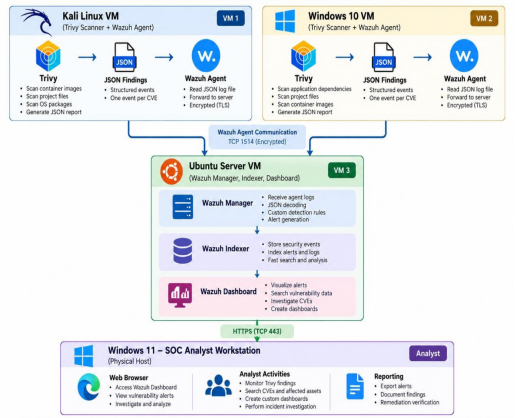
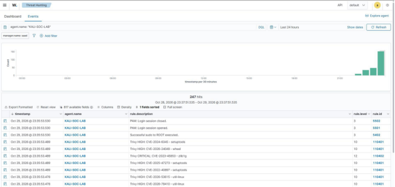
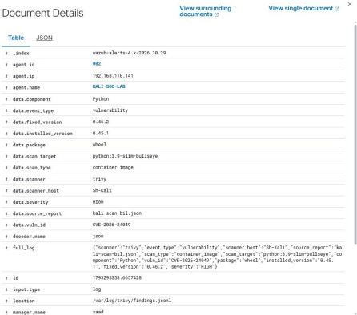
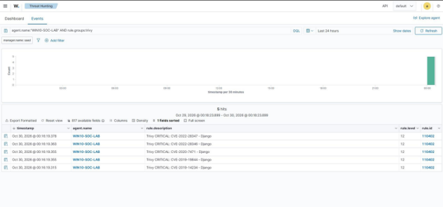
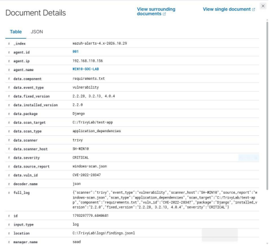

# Trivy + Wazuh SIEM Integration — Full Implementation Report

> **Lab:** Trivy Vulnerability Scanner + Wazuh SIEM Centralized Vulnerability Monitoring  
> **Author:** [@shii9](https://github.com/shii9)  
> **Status:** ✅ Verified & Operational

---

## 01 | Lab Architecture

This lab demonstrates the integration of **Trivy Vulnerability Scanner** with the **Wazuh SIEM platform** to establish centralized vulnerability monitoring across Kali Linux and Windows 10 endpoints.

| System | Function | Data Flow |
|---|---|---|
| **Kali Linux VM** | Trivy scans a Python container image; existing Wazuh Agent | `kali-scan-bil.json` → `findings.jsonl` |
| **Windows 10 VM** | Trivy scans test-app `requirements.txt`; existing Wazuh Agent | `windows-scan.json` → `findings.jsonl` |
| **Ubuntu Server VM** | Wazuh Manager + Indexer + Dashboard | JSON decoding → Rules 110401 / 110402 |
| **Windows 11 Host** | Analyst accesses Dashboard in web browser | HTTPS / TCP 443 |

<p align="center">
  
</p>
<p align="center"><em>Figure 1. Implemented Trivy-to-Wazuh monitoring architecture.</em></p>

---

## 02 | Install and Prepare Trivy

In this lab, Trivy was installed on Kali Linux and Windows 10 to perform vulnerability assessments. Both endpoints were already connected to the centralized Wazuh Manager through their respective Wazuh Agents.

### 2.1 — Kali Linux: Trivy Installation

```bash
sudo apt update
sudo apt install -y trivy jq
trivy --version
```

Create working directories for reports and normalized output:

```bash
mkdir -p ~/trivy-wazuh/reports
mkdir -p ~/trivy-wazuh/normalized
```

> **Note:** Although `trivy --version` displayed `dev`, the package installation output identified **Trivy version 0.76.0**.

### 2.2 — Windows 10: Trivy Installation

The Windows 64-bit Trivy package (`trivy_0.76.1_windows-64bit`) was downloaded from the official GitHub releases page:

🔗 https://github.com/aquasecurity/trivy/releases

The downloaded archive was extracted into the Downloads directory, containing the `trivy.exe` executable:

```powershell
cd "C:\Users\saada\Downloads\trivy_0.76.1_windows-64bit"
.\trivy.exe --version
```

Create working directories:

```powershell
New-Item -ItemType Directory -Force C:\TrivyLab\reports
New-Item -ItemType Directory -Force C:\TrivyLab\test-app
```

---

## 03 | Generate Vulnerability Reports

After installing Trivy on both endpoints, vulnerability scans were performed to identify known security weaknesses in container images and application dependencies. Trivy was configured to detect **HIGH** and **CRITICAL** vulnerabilities and export findings in JSON format.

### 3.1 — Kali Linux: Container Image Scanning

```bash
trivy image --image-src remote \
  --scanners vuln --severity HIGH,CRITICAL \
  --format json \
  --output ~/trivy-wazuh/reports/kali-scan-bil.json \
  python:3.9-slim-bullseye
```

The generated `kali-scan-bil.json` file contained structured vulnerability information including CVE identifiers, affected packages, severity levels, and available fixed versions.

### 3.2 — Windows 10: Application Dependency Scanning

On Windows 10, a test application directory was prepared with a `requirements.txt` file containing intentionally outdated Python dependencies, including **Django 2.2.0**:

```powershell
.\trivy.exe fs `
  --scanners vuln `
  --severity HIGH,CRITICAL `
  --format json `
  --output "C:\TrivyLab\reports\windows-scan.json" `
  "C:\TrivyLab\test-app"
```

The scan detected known security vulnerabilities associated with the declared application dependencies. The generated `windows-scan.json` report was subsequently used for Wazuh integration.

---

## 04 | Convert Nested JSON into Wazuh Events

Trivy's original JSON reports contain **nested structures and arrays** of vulnerability objects that the standard Wazuh JSON decoder cannot directly process as individual events. Therefore, the reports were converted into **JSON Lines (JSONL)** format, with each vulnerability represented as a separate structured event.

### 4.1 — Kali Linux: JSON to JSONL Conversion

The `jq` utility was used to extract vulnerability records from the `kali-scan-bil.json` report. The conversion separated the **108 reported findings** into individual JSONL events while retaining their CVE identifiers, affected packages, severity levels, and version information.

```bash
jq -c '
  .Results[]
  | .Target as $target
  | .Vulnerabilities[]?
  | {
      trivy: "vulnerability",
      scanner_host: "KALI-SOC-LAB",
      target: $target,
      vulnerability_id: .VulnerabilityID,
      package: .PkgName,
      installed_version: .InstalledVersion,
      fixed_version: (.FixedVersion // "none"),
      severity: .Severity,
      title: .Title,
      source_report: "kali-scan-bil.json"
    }
' ~/trivy-wazuh/reports/kali-scan-bil.json \
  > ~/trivy-wazuh/normalized/kali-scan-bil.jsonl
```

**Example normalized JSONL event:**

```json
{
  "trivy": "vulnerability",
  "scanner_host": "KALI-SOC-LAB",
  "target": "python:3.9-slim-bullseye (debian 11.11)",
  "vulnerability_id": "CVE-2026-24049",
  "package": "wheel",
  "installed_version": "0.45.1",
  "fixed_version": "0.46.2",
  "severity": "HIGH",
  "title": "wheel: Remote code execution via crafted wheel metadata",
  "source_report": "kali-scan-bil.json"
}
```

### 4.2 — Windows 10: JSON to JSONL Conversion

On Windows 10, a PowerShell-based processing script was used to transform the `windows-scan.json` report into structured vulnerability events:

```powershell
$report = Get-Content -Raw "C:\TrivyLab\reports\windows-scan.json" | ConvertFrom-Json

foreach ($result in $report.Results) {
    foreach ($vuln in $result.Vulnerabilities) {
        $event = [ordered]@{
            trivy              = "vulnerability"
            scanner_host       = $env:COMPUTERNAME
            target             = $result.Target
            vulnerability_id   = $vuln.VulnerabilityID
            package            = $vuln.PkgName
            installed_version  = $vuln.InstalledVersion
            fixed_version      = if ($vuln.FixedVersion) { $vuln.FixedVersion } else { "none" }
            severity           = $vuln.Severity
            title              = $vuln.Title
            source_report      = "windows-scan.json"
        }
        $event | ConvertTo-Json -Compress | Add-Content "C:\TrivyLab\logs\findings.jsonl"
    }
}
```

The resulting `windows-findings.jsonl` file was prepared for collection through the existing Windows Wazuh Agent.

---

## 05 | Configure Existing Wazuh Agents

The Kali Linux and Windows 10 endpoints were already connected to the centralized Wazuh Manager. However, the agents required additional configuration to collect Trivy-generated vulnerability findings.

### 5.1 — Kali Linux: Agent Configuration

The existing Wazuh Agent configuration on Kali Linux was updated:

```bash
sudo nano /var/ossec/etc/ossec.conf
```

The following block was added inside the existing `<ossec_config>` section:

```xml
<localfile>
  <log_format>json</log_format>
  <location>/var/log/trivy/findings.jsonl</location>
</localfile>
```

Restart the agent to apply:

```bash
sudo systemctl restart wazuh-agent
```

### 5.2 — Windows 10: Agent Configuration

On Windows 10, the Wazuh Agent configuration was modified using an administrator-level PowerShell session:

```powershell
notepad "C:\Program Files (x86)\ossec-agent\ossec.conf"
```

The following block was added inside the existing `<ossec_config>` section:

```xml
<localfile>
  <log_format>json</log_format>
  <location>C:\TrivyLab\logs\findings.jsonl</location>
</localfile>
```

Restart the agent:

```powershell
Restart-Service -Name WazuhSvc
```

---

## 06 | Custom Wazuh Detection Rules and Initial Event Forwarding

### Step 1 — Create the Rules File

On the Ubuntu Server, a dedicated file was created for Trivy vulnerability detection rules:

```bash
sudo nano /var/ossec/etc/rules/trivy_rules.xml
```

### Step 2 — Define Severity-Based Detection Rules

```xml
<group name="trivy,vulnerability,">

  <!-- Base rule: Identify any Trivy vulnerability event -->
  <rule id="110400" level="3">
    <decoded_as>json</decoded_as>
    <field name="trivy">\.+</field>
    <description>Trivy: Vulnerability finding detected.</description>
    <group>trivy,</group>
  </rule>

  <!-- HIGH severity vulnerability -->
  <rule id="110401" level="10">
    <if_sid>110400</if_sid>
    <field name="severity">HIGH</field>
    <description>Trivy: HIGH severity vulnerability —
      $(vulnerability_id) in $(package) $(installed_version).</description>
    <group>trivy,vulnerability_high,</group>
  </rule>

  <!-- CRITICAL severity vulnerability -->
  <rule id="110402" level="12">
    <if_sid>110400</if_sid>
    <field name="severity">CRITICAL</field>
    <description>Trivy: CRITICAL severity vulnerability —
      $(vulnerability_id) in $(package) $(installed_version).</description>
    <group>trivy,vulnerability_critical,</group>
  </rule>

</group>
```

| Rule ID | Alert Level | Detection Purpose |
|:---:|:---:|---|
| **110400** | 3 | Identify Trivy vulnerability events |
| **110401** | 10 | Detect HIGH-severity vulnerabilities |
| **110402** | 12 | Detect CRITICAL-severity vulnerabilities |

Restart the Wazuh Manager to apply:

```bash
sudo systemctl restart wazuh-manager
```

### Step 3 — Initial Vulnerability Event Forwarding

After configuring the custom detection rules, the normalized Trivy vulnerability findings were manually appended to the designated JSONL log files monitored by the existing Wazuh Agents:

**Kali Linux:**
```bash
cat ~/trivy-wazuh/normalized/kali-scan-bil.jsonl \
  | sudo tee -a /var/log/trivy/findings.jsonl > /dev/null
```

**Windows 10:**
```powershell
Get-Content "C:\TrivyLab\reports\windows-findings.jsonl" |
  Add-Content "C:\TrivyLab\logs\findings.jsonl"
```

Once the findings were written to the monitored files, the Wazuh Agents automatically collected and forwarded the events to the Ubuntu Wazuh Manager. The incoming events were decoded and analyzed using the custom detection rules, generating alerts based on vulnerability severity.

> **Result:** Initial vulnerability event forwarding was successfully verified from both endpoints, with HIGH and CRITICAL alerts displayed in the Wazuh Dashboard.

---

## 07 | Kali Linux — Observed Detection Evidence

Evidence from the actual Wazuh Threat Hunting session confirms that the Kali Linux agent successfully forwarded Trivy vulnerability events to the centralized dashboard.

<p align="center">
  
</p>
<p align="center"><em>Figure 2. Kali agent view showing real Trivy HIGH/CRITICAL alerts in the centralized dashboard. 247 hits from KALI-SOC-LAB with rules 110401 (HIGH) and 110402 (CRITICAL).</em></p>

<p align="center">
  
</p>
<p align="center"><em>Figure 3. Expanded Kali alert: CVE-2026-24049, wheel 0.45.1; fixed version 0.46.2, targeting python:3.9-slim-bullseye container image. Agent 002 (KALI-SOC-LAB), decoded as JSON from /var/log/trivy/findings.jsonl.</em></p>

---

## 08 | Windows 10 — Observed Detection Evidence

Application dependency alerts from the existing Windows Wazuh Agent confirmed successful integration:

<p align="center">
  
</p>
<p align="center"><em>Figure 4. Five CRITICAL Django-related Trivy events from WIN10-SOC-LAB; all matching Rule 110402 (Level 12). DQL filter: agent.name:"WIN10-SOC-LAB" AND rule.groups:trivy.</em></p>

<p align="center">
  
</p>
<p align="center"><em>Figure 5. Expanded Windows alert: CVE-2022-28347, Django 2.2.0 in requirements.txt, original report windows-scan.json. Agent 001 (WIN10-SOC-LAB), scan target C:\TrivyLab\test-app, severity CRITICAL, fixed versions 2.2.28, 3.2.13, 4.0.4.</em></p>

---

## 09 | Results, Scope, and Completion Status

### 9.1 — Implementation Summary

The Trivy–Wazuh integration was successfully implemented across Kali Linux and Windows 10 using the existing Wazuh SOC infrastructure. The lab demonstrated the complete process of:

1. Vulnerability scanning (container images + application dependencies)
2. JSON report generation
3. Event normalization (JSON → JSONL)
4. Wazuh Agent configuration
5. Centralized custom detection rules
6. Log forwarding and severity-based alert monitoring

### 9.2 — Step-by-Step Completion Status

| Step | Implementation Activity | Status |
|:---:|---|:---:|
| 01 | Lab Architecture and Environment Preparation | ✅ |
| 02 | Trivy Installation and Configuration | ✅ |
| 03 | Vulnerability Scanning and Report Generation | ✅ |
| 04 | JSON Normalization to JSONL Events | ✅ |
| 05 | Wazuh Agent Configuration for JSONL Collection | ✅ |
| 06 | Custom Detection Rules, Forwarding, and Verification | ✅ |

### 9.3 — Key Metrics

| Metric | Value |
|---|---|
| Kali Linux findings processed | 108 vulnerability events |
| Windows 10 findings processed | 5+ CRITICAL Django CVEs |
| Custom Wazuh rules deployed | 3 (110400, 110401, 110402) |
| Endpoints integrated | 2 (Kali Linux + Windows 10) |
| Severity levels monitored | HIGH (Level 10) + CRITICAL (Level 12) |

---

<p align="center">
  <b>Trivy + Wazuh SIEM Integration Lab</b> • End-to-end vulnerability monitoring with centralized detection and alerting.
</p>
